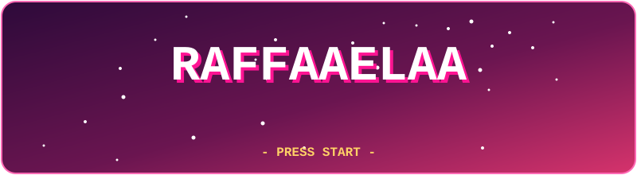
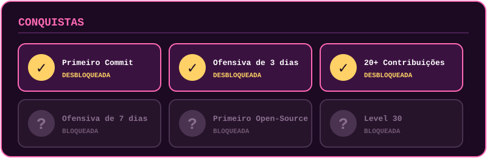

 

**[Status](#status)** · **[Habilidades](#habilidades)** · **[Guild](#guild)** · **[Inventário](#inventário)** · **[Quests](#quests)** · **[Conquistas](#conquistas)** · **[Minigame](#minigame)**

 

---

## Status

> Clique nas setas **▶** abaixo para abrir os detalhes. Tem segredo escondido!

---

## Habilidades

<b>CSS3</b> — Magia de Estilo · Nível 9

- **Habilidade ativa:** Feitiço de Layout (Flexbox e Grid)
- **Passiva:** animações que encantam
- **Próximo upgrade:** Container Queries e `@layer`

<b>C#</b> — Magia Arcana · Nível 8

- **Habilidade ativa:** Invocar Classes (POO)
- **Próximo upgrade:** LINQ avançado, SOLID e padrões de projeto

<b>HTML5</b> — Fundação do Reino · Nível 8

- **Habilidade ativa:** Semântica Sagrada e acessibilidade
- **Passiva:** estrutura sólida em qualquer projeto

<b>JavaScript</b> — Magia Elemental · Nível 7

- **Habilidade ativa:** Manipular o DOM
- **Próximo upgrade:** Async/Await, APIs e módulos ES

<b>C</b> — Runas Antigas · Nível 6

- **Habilidade ativa:** Controle de Memória (ponteiros)
- **Passiva:** entender como as coisas funcionam por baixo do capô

---

## Guild

<b>Resumo do mapa</b>

| Métrica | Valor | Status no mapa |
|:---|:---:|:---|
| Total de contribuições | **20+** | Missões cumpridas com sucesso |
| Ofensiva atual | **3 dias** | Foco diário mantido |
| Linguagem principal | **JavaScript / HTML** | Domínio elementar ativado |

---

## Inventário

<b>Abrir mochila</b> (3 itens equipados)

| Slot | Item mágico | Raridade | Efeito ativo |
|:---:|:---|:---:|:---|
| 🗡️ | **Espada do Debug** | Épico | Elimina bugs teimosos instantaneamente |
| ☕ | **Poção de Café** | Comum | Restaura +50 de energia mental e foco |
| 📖 | **Grimório de Docs** | Raro | Consulta rápida de sintaxes e códigos |
| 🔒 | **???** | Bloqueado | Desbloqueie publicando um repo open-source |

---

## Quests

---

## Conquistas

<b>Segredo escondido</b>

🎉 **Você encontrou o baú secreto!** `+999 XP`

Fun fact: já perdi 2 horas de debug por causa de um ponto e vírgula.

---

## Minigame

*A cobrinha está devorando seus commits e construindo suas conquistas diárias!*

  

*"Toda grande maga do código já foi uma aprendiz na chaveta inicial."*

